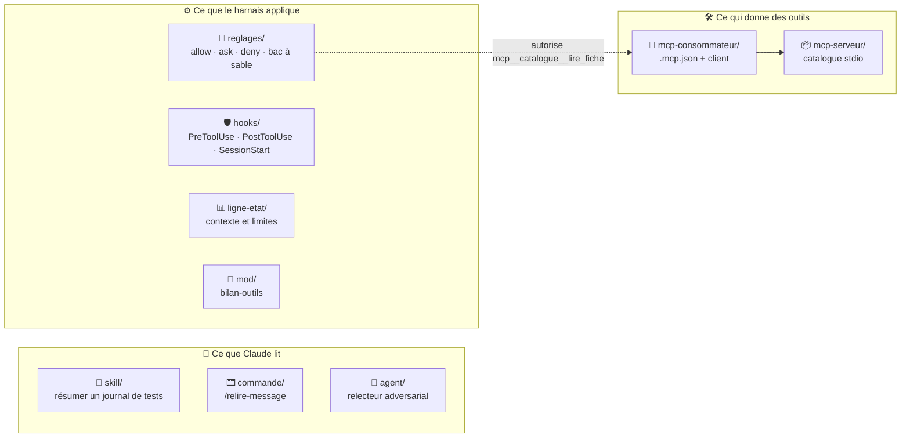

<!-- SPDX-FileCopyrightText: 2026 Gabrielle Magnan -->
<!-- SPDX-License-Identifier: MIT -->
# Exemples de code pour les artefacts clés de Claude Code

Neuf exemples **minimaux, commentés en français et testés**, un dossier par artefact. Chacun a son README : ce qu'il montre, comment l'installer, comment le tester, ses limites et les pages de documentation vérifiées (lues le **2026-11-02**).

Tout est écrit en **Python, bibliothèque standard seulement** (sauf le mod : un mod est un module JavaScript ou TypeScript ; l'exemple est écrit en JavaScript). Aucune donnée réelle : le catalogue d'exemple est synthétique (`FICHE-001`…, `RESP-014`…).

**Licence** : © 2026 Gabrielle Magnan. Tous les fichiers de ce dossier sont sous licence MIT : voir le fichier [`LICENSE`](LICENSE). Vous pouvez les utiliser, les copier, les modifier et les redistribuer, y compris dans un projet professionnel, en gardant la mention de droit d'auteur et le texte de la licence. Le texte du guide, lui, reste sous [CC BY-NC-ND 4.0](https://creativecommons.org/licenses/by-nc-nd/4.0/deed.fr).

Chaque fichier qui admet un commentaire porte en tête deux lignes : la mention de droit d'auteur (`SPDX-FileCopyrightText`) et le nom de la licence (`SPDX-License-Identifier: MIT`). Dans un script, elles suivent la ligne `#!` ; dans un skill, un agent ou une commande, elles suivent le frontmatter. Treize fichiers n'en portent pas, et le fichier `LICENSE` les couvre : les sept fichiers JSON, qui n'admettent pas de commentaire (`hooks/exemple.settings.json`, `ligne-etat/exemple.settings.json`, `reglages/exemple.settings.json`, `mcp-consommateur/exemple.mcp.json`, `mcp-serveur/donnees/index.json`, `mod/bilan-outils/.claude-plugin/plugin.json`, `mod/bilan-outils/hooks/hooks.json`), et six fichiers de données, où une ligne de plus deviendrait du contenu (`mcp-serveur/donnees/fiches/FICHE-001.md` à `FICHE-003.md`, `mon-essai/documents/ESSAI-C-001.txt` à `ESSAI-C-003.txt`).

## Lancer tous les tests

Depuis le dossier qui contient `exemples/` :

```bash
python -I -B -m unittest discover -s exemples -p "test_*.py"
```

- `-I` : mode isolé (ni le dossier courant ni les variables `PYTHON*` n'influencent les imports) ; `-B` : aucun `.pyc` écrit.
- Chaque dossier d'exemple contient un `__init__.py` vide : sans lui, `unittest discover` ne descend pas dans le dossier.
- Résultat attendu : **91 tests, OK**, dont 1 sauté là où le système ne permet pas de créer un lien symbolique (Windows sans mode développeur). Mesuré le 2026-11-21 sous Windows 11 avec Python 3.14.4 : `Ran 91 tests`, `OK (skipped=1)`.
- Sous Windows, les scripts appelés par les tests écrivent leur sortie en UTF-8, quelle que soit la page de code du système : sans cela, un flux redirigé suivrait la page de code locale, et les accents deviendraient illisibles pour l'hôte qui les lit.

## La carte des exemples



## Le dossier d'essai

[`mon-essai/`](mon-essai/README.md) n'est pas un exemple d'artefact : c'est le dossier du premier projet de la lectrice ou du lecteur, à copier au jour 1 (section 2.1 et annexe A du guide). Il contient trois documents inventés, `ESSAI-C-001` à `ESSAI-C-003`, et le contrôle de référence `controle_dates.py`, avec ses 9 tests. Il n'a pas de `__init__.py` : la commande ci-dessus n'y descend pas, et le compte de 91 tests ne change pas. Il se teste depuis lui-même, par `python -I -B -m unittest -v`.

## L'index

Ordre de lecture conseillé, du débutant à l'expert.

| # | Dossier | Ce qu'il montre | Installer | Tester | Limites principales |
|---|---|---|---|---|---|
| 1 | [`commande/`](commande/README.md) | Une commande slash à arguments nommés (`/relire-message <fichier> [public]`), en skill invoqué par l'utilisateur, et l'ancien format `.claude/commands/` | copier dans `.claude/skills/` | forme du frontmatter, arguments déclarés et utilisés | substitution réelle non testée ici |
| 2 | [`skill/`](skill/README.md) | Un skill complet : description qui déclenche, `references/` chargé à la demande, script appelé par `${CLAUDE_SKILL_DIR}` | copier dans `.claude/skills/` ou `~/.claude/skills/` | script sur journaux unittest et pytest, forme du `SKILL.md` | déclenchement par Claude non testé ici |
| 3 | [`agent/`](agent/README.md) | Un sous-agent relecteur adversarial, outils `Read, Grep, Glob` seulement, rapport à gabarit fixe | copier dans `.claude/agents/` | forme, moindre privilège, modèle valide | qualité de la relecture : à évaluer en session |
| 4 | [`reglages/`](reglages/README.md) | Un `settings.json` de projet commenté : `allow` / `ask` / `deny`, bac à sable, et **pourquoi un `deny` par motif ne suffit pas** | copier en `.claude/settings.json` | syntaxe des règles, cohérence avec l'exemple MCP | **pas de bac à sable sous Windows natif** |
| 5 | [`mcp-serveur/`](mcp-serveur/README.md) | Un serveur MCP stdio en JSON-RPC 2.0, un outil en lecture seule, refus des chemins hors racine, **deux révisions du protocole** (2025-11-25 et 2026-07-28) | rien : Python seul | poignée de main jouée par un sous-processus, refus, erreurs | pas de pagination ni d'abonnements |
| 6 | [`mcp-consommateur/`](mcp-consommateur/README.md) | Le `.mcp.json` de projet, `claude mcp add`, les règles `mcp__<serveur>__<outil>`, un client de test qui joue l'hôte | copier `exemple.mcp.json` en `.mcp.json` | lancement avec la commande exacte du fichier, repli d'une ère à l'autre | chargement réel par Claude Code non testé ici |
| 7 | [`hooks/`](hooks/README.md) | `PreToolUse` qui bloque (code 2 ou décision JSON), `PostToolUse` qui contrôle, `SessionStart` qui ajoute du contexte, et leur bloc de réglages | copier dans `.claude/hooks/` + bloc `hooks` | JSON documenté envoyé sur stdin | ⚠️ le chargement réel par Claude Code n'est pas testé ici ; pas une frontière de sécurité |
| 8 | [`ligne-etat/`](ligne-etat/README.md) | Une ligne d'état qui lit modèle, contexte et `rate_limits` quand ils sont présents, avec un **mot** pour chaque niveau | copier + bloc `statusLine` | schéma documenté, champs absents ou `null` | ⚠️ le chargement réel par Claude Code n'est pas testé ici |
| 9 | [`mod/`](mod/README.md) | Un mod (plugin à module de hooks) : compteur d'appels d'outils et commande `/bilan-outils`, en lecture seule | `claude --plugin-dir ./bilan-outils` | structure et analyse statique en Python ; `claude plugin test` **lancé le 2026-11-06 avec Claude Code 2.1.318 : 3 tests passent** | ⚠️ API qui change vite |

## Les règles communes à tous les exemples

- **Rien ne s'installe tout seul.** Les fichiers de configuration s'appellent `exemple.*.json` : ouvrir ce dossier dans Claude Code n'active ni serveur, ni hook, ni réglage. On copie, on relit, puis on active.
- **Sûreté** : le serveur MCP parle sur stdio et n'ouvre aucun port ; aucun exemple ne fait d'appel réseau, n'utilise de CDN ni de télémétrie ; aucun secret, même factice.
- **Chemins** : uniquement relatifs, ou `~`. Sous Windows, écrivez les chemins avec `/` dans les commandes des réglages : Git Bash, quand il est installé, mange les `\`.
- **Ce qu'une politique d'organisation change** : si les réglages gérés posent `allowManagedHooksOnly`, les hooks, la ligne d'état et les mods de ces exemples ne tournent pas. Les skills, la commande, l'agent, le serveur MCP et les règles de permission, eux, restent utilisables. Vérifiez par `/status`, ligne `Setting sources`.
- **Ce que les tests prouvent** : le contrat documenté (formats d'entrée et de sortie, structure des fichiers), pas le comportement de Claude Code lui-même. Chaque README dit ce qui reste à vérifier en session.

## Pages de documentation vérifiées (2026-11-02)

| Page | Exemples |
|---|---|
| [Skills](https://code.claude.com/docs/en/skills.md) | skill, commande |
| [Subagents](https://code.claude.com/docs/en/sub-agents.md) | agent |
| [Hooks reference](https://code.claude.com/docs/en/hooks.md) | hooks |
| [MCP](https://code.claude.com/docs/en/mcp.md) | mcp-serveur, mcp-consommateur |
| [Status line](https://code.claude.com/docs/en/statusline.md) | ligne-etat |
| [Settings](https://code.claude.com/docs/en/settings.md), [Settings reference](https://code.claude.com/docs/en/settings-reference.md) | reglages, hooks, ligne-etat, mod |
| [Permissions](https://code.claude.com/docs/en/permissions.md) | reglages, mcp-consommateur, hooks |
| [Sandboxing](https://code.claude.com/docs/en/sandboxing.md) | reglages, hooks |
| [Plugins](https://code.claude.com/docs/en/plugins.md), [Mods overview](https://code.claude.com/docs/en/plugins/mods/overview.md), [Create a mod](https://code.claude.com/docs/en/plugins/mods/create.md), [Events](https://code.claude.com/docs/en/plugins/mods/events.md), [Test a mod](https://code.claude.com/docs/en/plugins/mods/test.md) | mod |
| Spécification MCP : [latest](https://modelcontextprotocol.io/specification/latest), [changelog 2026-07-28](https://modelcontextprotocol.io/specification/2026-07-28/changelog), [versioning](https://modelcontextprotocol.io/specification/2026-07-28/basic/lifecycle), [base](https://modelcontextprotocol.io/specification/2026-07-28/basic/index), [stdio](https://modelcontextprotocol.io/specification/2026-07-28/basic/transports/stdio), [discover](https://modelcontextprotocol.io/specification/2026-07-28/server/discover), [tools](https://modelcontextprotocol.io/specification/2026-07-28/server/tools), [schema](https://modelcontextprotocol.io/specification/2026-07-28/schema), [lifecycle 2025-11-25](https://modelcontextprotocol.io/specification/2025-11-25/basic/lifecycle), [tools 2025-11-25](https://modelcontextprotocol.io/specification/2025-11-25/server/tools) | mcp-serveur, mcp-consommateur |

La documentation évolue vite : avant de recopier un nom de champ dans un vrai projet, relisez la page du jour.
