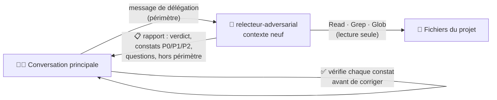

<!-- SPDX-FileCopyrightText: 2026 Gabrielle Magnan -->
<!-- SPDX-License-Identifier: MIT -->
# Un sous-agent : relecteur adversarial en lecture seule

## Ce que montre l'exemple

`relecteur-adversarial.md` est un fichier de sous-agent : un frontmatter YAML, puis un corps Markdown qui **devient son prompt système**.

| Champ | Valeur | Pourquoi |
|---|---|---|
| `name` | `relecteur-adversarial` | Obligatoire. 256 caractères au plus, sans `:`. |
| `description` | « À utiliser après une modification et avant un commit… » | Obligatoire. C'est sur ce texte que Claude décide de déléguer : il dit **quand**, pas seulement quoi. |
| `tools` | `Read, Grep, Glob` | **Moindre privilège** : sans ce champ, l'agent hérite de tous les outils de la conversation, MCP compris. Ici, il ne peut ni écrire, ni exécuter, ni lancer un autre sous-agent (l'outil `Agent` n'est pas listé). La garantie vient du harnais, pas d'une consigne : le relecteur ne peut pas éditer, quoi qu'il décide. |
| `model` | `sonnet` | Alias documenté (`sonnet`, `opus`, `haiku`, `fable`, `inherit`, ou un identifiant complet). |

Pas de `maxTurns`. Ce champ arrête l'agent après un nombre de tours et rend sa sortie marquée partielle, que Claude peut reprendre. Un plafond coupe un long travail avant son rapport : l'arrêt de cet agent passe par son brief, le message qui le lance, avec son critère de fin et son budget.

Le corps **se suffit à lui-même**, parce qu'un sous-agent démarre avec un contexte neuf : il ne voit ni la conversation, ni les fichiers déjà lus, seulement son prompt, quelques détails d'environnement, les fichiers `CLAUDE.md` et le message de délégation. D'où, dans le corps : la méthode, la règle « lire les artefacts avant les conclusions » (contre l'ancrage), et un **format de rapport fixe**, que la conversation principale peut relire et vérifier.



## Installer

Copiez le fichier :

| Emplacement | Portée |
|---|---|
| `.claude/agents/relecteur-adversarial.md` | Ce projet (versionnable pour l'équipe) |
| `~/.claude/agents/relecteur-adversarial.md` | Vous, dans tous vos projets |

Puis, dans une session :

- en langage naturel : « fais relire mes changements par le relecteur adversarial » ;
- par mention : `@agent-relecteur-adversarial relis src/` ;
- ou `/agents` pour voir les agents chargés.

`claude --agent relecteur-adversarial` existe aussi, mais change la nature de la session : le prompt de l'agent **remplace alors entièrement** le prompt système de Claude Code. Pour un relecteur, la délégation depuis une session normale est le bon usage.

## Tester

```bash
python -I -B -m unittest discover -s exemples -p "test_*.py"
```

`test_agent.py` vérifie la forme : champs obligatoires, nom égal au nom du fichier et sans `:`, outils inclus dans `Read`, `Grep`, `Glob`, modèle parmi les valeurs documentées, aucun plafond de tours, présence du gabarit de rapport.

## Limites

- **Non testé ici** : la qualité de la relecture elle-même. Elle s'évalue en session, sur un changement où l'on a placé exprès deux ou trois défauts connus.
- Un rapport d'agent est une **donnée** pour la conversation principale : elle vérifie chaque constat avant de corriger.
- Sous une politique d'organisation qui n'autorise que les hooks gérés (`allowManagedHooksOnly`), les `hooks` déclarés dans le frontmatter d'un agent sont bloqués ; cet exemple n'en déclare pas.

## Sources lues le 2026-11-02

- Claude Code, [Create custom subagents](https://code.claude.com/docs/en/sub-agents.md) : emplacements et priorités, champs du frontmatter, valeurs de `model`, syntaxe de `tools`, contexte reçu au démarrage, invocation par `@`, `--agent` et remplacement du prompt système.
- Claude Code, [Settings reference](https://code.claude.com/docs/en/settings-reference.md), section *What runs under `allowManagedHooksOnly`*.
