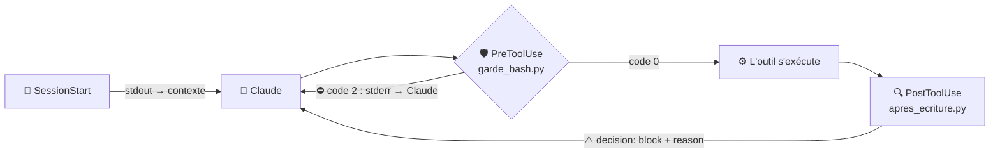

<!-- SPDX-FileCopyrightText: 2026 Gabrielle Magnan -->
<!-- SPDX-License-Identifier: MIT -->
# Hooks : bloquer avant, contrôler après, préparer au démarrage

> ⚠️ **À lire d'abord : votre organisation peut éteindre ces hooks.** Si les réglages gérés posent `allowManagedHooksOnly: true`, Claude Code n'exécute que les hooks gérés par l'organisation, ceux de l'Agent SDK et ceux des plugins qu'elle force. **Tout le reste est bloqué**, sans erreur visible : hooks utilisateur, de projet et locaux, hooks et mods des autres plugins, hooks déclarés dans le frontmatter d'un agent. La ligne d'état personnalisée ne vient plus que des réglages gérés, et `/goal` ne peut pas tourner. Pour savoir ce qui s'applique : `/status`, ligne `Setting sources`.
>
> **Conséquence de conception** : ne bâtissez jamais un contrôle *indispensable* sur un hook de session. Doublez-le d'une étape qui marche quel que soit le verrou : un hook git `pre-commit`, une recette du gestionnaire de tâches, un script lancé à la main.

## Ce que montre l'exemple

| Script | Événement | Ce qu'il fait | Comment il répond |
|---|---|---|---|
| `garde_bash.py` | `PreToolUse`, matcher `Bash` | Bloque `rm -rf /`, `curl … \| sh`, `git push --force`, `git reset --hard`, `mkfs`, `dd of=/dev/…`, `chmod -R 777`, y compris derrière `sudo`, `timeout`, `/bin/rm` ou `bash -c '…'` | **Code 2** + raison sur **stderr** (par défaut), ou, avec `--json`, une **décision JSON** `deny` ou `ask` |
| `apres_ecriture.py` | `PostToolUse`, matcher `Write\|Edit` | Contrôle le fichier écrit : syntaxe Python (compilation en mémoire), JSON valide | `{"decision": "block", "reason": "…"}` : la raison s'affiche à côté du résultat, Claude corrige |
| `debut_session.py` | `SessionStart` | Ajoute au contexte les notes d'équipe `NOTES-SESSION.md` du projet, au démarrage, à la reprise, après `/clear` et après une compaction | Texte brut sur stdout : pour `SessionStart`, il est ajouté au contexte |
| `exemple.settings.json` | — | Le bloc `hooks` qui déclare les trois, et les règles `deny` qui protègent leurs scripts et leur déclaration | — |



### Les codes de sortie, d'après la doc

| Code | Sens | `PreToolUse` | `PostToolUse` | `SessionStart` |
|---|---|---|---|---|
| **0** | succès ; le JSON sur stdout est appliqué | l'outil continue (ou la décision JSON s'applique) | rien | stdout ajouté au contexte |
| **2** | erreur **bloquante** ; stderr = la raison | ⛔ **l'appel est bloqué** | ne bloque pas (l'outil a tourné) ; stderr montré à Claude | ne bloque pas ; stderr montré à la personne seulement |
| autre | erreur **non bloquante** ; l'action continue | ⚠️ **passe** (sauf `onFailure: "block"`) | — | — |

D'où la règle de la doc : **un hook qui fait respecter une politique sort en code 2**, jamais en code 1. `garde_bash.py` sort aussi en code 2 quand son entrée est illisible ou de forme inattendue : une garde qui échoue doit fermer, pas ouvrir. Son bloc de réglages porte en plus `onFailure: "block"`, qui demande Claude Code 2.1.295 ou plus.

### La décision JSON de `PreToolUse`

```json
{
  "hookSpecificOutput": {
    "hookEventName": "PreToolUse",
    "permissionDecision": "deny",
    "permissionDecisionReason": "garde_bash : rm récursif et forcé sur / : refusé"
  }
}
```

`permissionDecision` vaut `allow`, `deny`, `ask` ou `defer` (ce dernier seulement en mode non interactif `-p`). Quand plusieurs hooks répondent : `deny` > `defer` > `ask` > `allow`. Les anciens champs de premier niveau `decision` / `reason` sont **dépréciés pour cet événement**.

**Un hook ne lève jamais une règle** : les règles `deny` et `ask` des réglages s'appliquent quoi que le hook réponde, même `allow`.

## Installer

1. Copiez les trois scripts dans `.claude/hooks/` à la racine du projet.
2. Fusionnez le bloc `hooks` de `exemple.settings.json` dans `.claude/settings.json` (partagé) ou `.claude/settings.local.json` (vous seul), et ses règles `deny` de `permissions` dans `.claude/settings.json`. Les réglages sont du JSON strict : pas de commentaire. Si le fichier a déjà un objet `"permissions"` ou `"hooks"`, ajoutez-y ces entrées au lieu d'en coller un second.
3. Dans une session, `/hooks` liste les hooks chargés, et `/permissions` les règles. Une modification directe du fichier est normalement prise en compte sans relancer la session ; si `/hooks` ne montre pas le changement, relancez-la.

**Pourquoi ces `deny`.** Un hook lance ses scripts à chaque événement, sans rien demander, avec tous vos droits, hors du bac à sable. Si Claude pouvait réécrire `garde_bash.py`, ou la ligne qui le déclare, le hook lancerait sans vous le code qu'il vient d'écrire, comme une règle `allow`. Les trois hooks ont leur ligne au tableau 17.3 du guide (section 17.2), avec ces règles. Tant que les hooks sont installés, `Edit(./.claude/hooks/**)` et les deux fichiers de réglages en `deny` arrêtent sur ces chemins les outils d'écriture de Claude (`Edit`, `Write`, `NotebookEdit`), les commandes du shell que Claude Code reconnaît, comme `tee`, et la cible d'une redirection `>`. Ils n'arrêtent pas un script qui écrit lui-même. Le dossier `.claude/` est déjà un chemin protégé, mais une écriture y est demandée en mode Manual et en `acceptEdits`, et passe au classificateur en mode auto : le `deny` rend le refus ferme dans tous les modes. Mettez ces règles dans `.claude/settings.json`, même si les hooks vont dans `.claude/settings.local.json` : elles valent alors sur chaque poste. Pour ajouter ou changer un hook, faites-le vous-même, dans votre éditeur, puis relisez son diff : la règle n'arrête que Claude.

Points de la doc appliqués dans le bloc :

- **Forme « exec »** (`command` + `args`) : pas de shell intermédiaire, donc pas de problème de guillemets ni de barres obliques inverses. Sous Windows, cette forme exige un vrai `.exe` (`python.exe` convient ; un `.cmd` ou un `.bat` non). Sous macOS et Linux, la commande s'appelle souvent `python3` : remplacez les trois `"command": "python"` par `"command": "python3"`, ou, dans une équipe qui mêle les systèmes, mettez le bloc dans le `.claude/settings.local.json` de chaque poste.
- **`${CLAUDE_PROJECT_DIR}`** : la racine du projet où la session a démarré ; elle reste la même quand Claude entre dans un worktree, alors que `cwd` le suit.
- **`timeout`** en secondes (défaut : 600 pour un hook `command`).
- **`onFailure: "block"`** sur la garde : si le script échoue autrement (code 1, plantage), l'appel est bloqué au lieu de passer. Ce champ demande Claude Code 2.1.295 ou plus.
- **Matchers** : `Bash` est un nom exact ; `Write|Edit` une liste ; un matcher avec d'autres caractères est une expression régulière. `SessionStart` n'a pas de matcher ici : il se déclenche pour toutes les sources, et le script lit `source` lui-même.

## Tester

```bash
python -I -B -m unittest discover -s exemples -p "test_*.py"
```

`test_hooks.py` envoie à chaque script le **JSON documenté** sur stdin (champs communs `session_id`, `transcript_path`, `cwd`, `permission_mode`, `hook_event_name`, puis `tool_name`, `tool_input`, `tool_use_id`, et `tool_response` pour `PostToolUse`, `source` pour `SessionStart`). Il vérifie 15 commandes dangereuses bloquées, 8 commandes ordinaires qui passent, deux entrées JSON valides mais mal formées bloquées (code 2), la sortie JSON `deny` / `ask`, le contrôle après écriture (aucun `.pyc` créé, fichier hors projet ignoré), l'ajout de contexte, et la structure du bloc de réglages (événements documentés, scripts présents, scripts et déclaration protégés en écriture par un `deny`).

Un essai à la main, sans Claude Code :

```bash
echo '{"hook_event_name":"PreToolUse","tool_name":"Bash","tool_input":{"command":"rm -rf /"}}' | python -I -B garde_bash.py
echo $?   # 2
```

## Limites

- **Ce n'est pas une frontière de sécurité.** `garde_bash.py` reconnaît des textes ; il ne voit ni une commande assemblée dans une variable, ni un script qui fait le travail, ni `git push origin +main` (forçage par refspec). Les mêmes limites valent pour les règles `deny` par motif (voir [`../reglages/`](../reglages/README.md)). Le confinement réel vient du bac à sable, qui n'existe pas sous Windows natif.
- Les hooks s'exécutent **hors du bac à sable**, avec vos droits : relisez un hook avant de l'installer comme vous reliriez un script.
- Le hook ne couvre que l'outil `Bash`. L'outil `PowerShell` a son propre nom ; ses champs d'entrée n'ont pas été vérifiés ici.
- **Non testé ici** : l'exécution par Claude Code lui-même (installer les hooks dans une configuration réelle est hors du périmètre de ces exemples). Les tests jouent le contrat documenté d'entrée et de sortie, pas le produit.
- Un `PostToolUse` ne peut rien annuler : il informe. Pour empêcher, c'est `PreToolUse`.
- Dans un dépôt d'origine inconnue, `NOTES-SESSION.md` est un contenu non fiable que ce hook injecte dans le contexte.
- La ligne `$schema` sert à l'éditeur ; il peut la télécharger : retirez-la sur un poste hors ligne.

## Sources lues le 2026-11-02

- Claude Code, [Hooks reference](https://code.claude.com/docs/en/hooks.md) : liste des événements, structure `hooks` → matcher → handlers, syntaxe des matchers, champs d'entrée communs et par événement, codes de sortie par événement, sortie JSON (`continue`, `systemMessage`, `decision`, `hookSpecificOutput`, `permissionDecision`, `additionalContext`, `updatedInput`), `CLAUDE_PROJECT_DIR`, forme exec et Windows, `onFailure`, `stop_hook_active` pour `Stop`.
- Claude Code, [Settings reference](https://code.claude.com/docs/en/settings-reference.md) : *What runs under `allowManagedHooksOnly`*, `disableAllHooks`.
- Claude Code, [Configure permissions](https://code.claude.com/docs/en/permissions.md) : un hook `PreToolUse` pour inspecter le texte complet d'une commande ; les règles `deny` et `ask` restent évaluées.
- Claude Code, [Sandboxing](https://code.claude.com/docs/en/sandboxing.md) : les hooks s'exécutent hors du bac à sable.
- Lues le 2026-11-09 : Claude Code, [Permission modes](https://code.claude.com/docs/en/permission-modes.md), section « Protected paths » (`.claude/` demandé en `default` et `acceptEdits`, confié au classificateur en `auto`, permis en `bypassPermissions`) ; [Configure permissions](https://code.claude.com/docs/en/permissions.md) (une règle `Edit` couvre `Write` et `NotebookEdit`, les commandes reconnues comme `tee` et les cibles de redirection, pas un script qui ouvre les fichiers lui-même) ; [Hooks reference](https://code.claude.com/docs/en/hooks.md) (« Direct edits to hooks in settings files are normally picked up automatically by the file watcher »).
