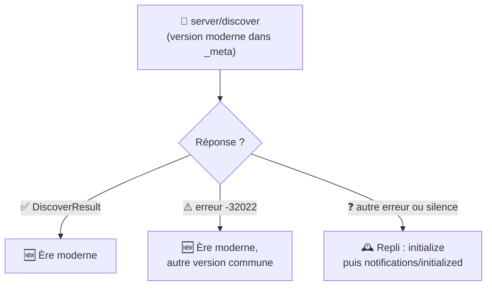

<!-- SPDX-FileCopyrightText: 2026 Gabrielle Magnan -->
<!-- SPDX-License-Identifier: MIT -->
# Consommer un serveur MCP : déclaration, permissions et client de test

## Ce que montre l'exemple

| Fichier | Rôle |
|---|---|
| `exemple.mcp.json` | La déclaration **de projet** du serveur de [`../mcp-serveur/`](../mcp-serveur/README.md), à copier sous le nom `.mcp.json` à la racine d'un projet. |
| `client_hote.py` | Un petit client MCP en bibliothèque standard, qui appelle le serveur **comme le ferait un hôte** : utile pour vérifier un serveur avant de le déclarer. |
| `test_client_hote.py` | Les tests : structure du `.mcp.json`, lancement avec la commande exacte du fichier, détection de l'ère du serveur et repli. |

Le fichier s'appelle `exemple.mcp.json`, et non `.mcp.json`, **exprès** : ainsi, ouvrir ce dossier dans Claude Code ne propose aucun serveur.

## Déclarer le serveur à Claude Code

### Option 1 : le fichier de projet `.mcp.json`

Copiez `exemple.mcp.json` à la racine du projet sous le nom `.mcp.json`, puis versionnez-le si l'équipe doit l'avoir :

```json
{
  "mcpServers": {
    "catalogue": {
      "type": "stdio",
      "command": "python",
      "args": ["-I", "-B", "${CATALOGUE_SERVEUR:-exemples/mcp-serveur/serveur_catalogue.py}"],
      "env": {}
    }
  }
}
```

- **`${CATALOGUE_SERVEUR:-...}`** : Claude Code développe `${VAR}` et `${VAR:-défaut}` dans `command`, `args`, `env`, `url` et `headers`. Chacun peut ainsi pointer vers sa copie du serveur sans modifier le fichier partagé. Attention : une variable définie **mais vide** compte comme définie, et donne une chaîne vide.
- **Le chemin par défaut est relatif** à la racine du projet où l'on copie le fichier. La documentation lue ne dit pas explicitement dans quel dossier Claude Code lance un serveur stdio de projet : si le serveur ne démarre pas, donnez un chemin complet dans `CATALOGUE_SERVEUR`, avec des barres obliques `/` (ou `~`).
- **`python`** doit être dans le `PATH` ; sous Windows, `py` est une autre possibilité. Sous macOS et Linux, la commande s'appelle souvent `python3` : écrivez alors `"command": "python3"`, et `python3` dans les deux commandes de l'option 2.
- **Approbation** : en session interactive, Claude Code demande votre accord avant d'utiliser un serveur déclaré par un `.mcp.json` de projet. `claude mcp reset-project-choices` efface ces choix. ⚠️ En `claude -p`, avec l'Agent SDK et dans certaines sessions cloud, il **ne peut pas demander** et charge les serveurs de projet sans accord ; pour en exclure un : `disabledMcpjsonServers`, `--setting-sources`, ou `--strict-mcp-config`.

### Option 2 : la ligne de commande

Syntaxe documentée : `claude mcp add [options] <nom> -- <commande> [args...]`. Le `--` sépare les options de Claude Code (`--transport`, `--scope`, `--env`) de la commande du serveur, transmise telle quelle.

```bash
# Portée « project » : écrit l'entrée dans le .mcp.json du projet
claude mcp add --transport stdio --scope project catalogue -- python -I -B exemples/mcp-serveur/serveur_catalogue.py

# Variante en JSON
claude mcp add-json catalogue '{"type":"stdio","command":"python","args":["-I","-B","exemples/mcp-serveur/serveur_catalogue.py"]}'

claude mcp list          # état de chaque serveur (connecté, échec…)
claude mcp get catalogue
claude mcp remove catalogue
```

Les trois portées : `local` (défaut : vous, dans ce projet), `project` (l'équipe, par `.mcp.json`), `user` (vous, dans tous vos projets). Dans une session, `/mcp` affiche l'état des serveurs et le nom complet de chaque outil.

## Les règles de permission

Claude Code nomme un outil MCP `mcp__<serveur>__<outil>` ; ici : **`mcp__catalogue__lire_fiche`**.

| Règle | Effet |
|---|---|
| `"allow": ["mcp__catalogue__lire_fiche"]` | ✅ Cet outil précis passe sans demande. |
| `"allow": ["mcp__catalogue__*"]` | ✅ Tous les outils du serveur `catalogue`. Un joker n'est accepté en `allow` qu'**après** un préfixe littéral `mcp__<serveur>__`. |
| `"allow": ["mcp__*"]` | ⚠️ **Ignorée** : un joker non ancré en `allow` n'approuve rien. |
| `"deny": ["mcp__*"]` | ⛔ Retire **tous** les outils MCP du contexte de Claude. |
| `"deny": ["mcp__catalogue__lire_fiche(...)"]` | ⚠️ **Ignorée** au chargement : une règle `mcp__` avec parenthèses est sautée. Pour filtrer un paramètre d'outil MCP : `--disallowedTools`. |

Le fichier [`../reglages/exemple.settings.json`](../reglages/README.md) autorise l'outil par son nom exact.

## Le client de test

```bash
# Depuis ce dossier
python -I -B client_hote.py --outil lire_fiche --arguments '{"chemin": "index.json"}' -- python -I -B ../mcp-serveur/serveur_catalogue.py
```

Sortie attendue (extrait) :

```text
ère : moderne ; version : 2026-07-28 ; serveur : catalogue-synthetique
outil : lire_fiche — Lire une fiche du catalogue
appel lire_fiche : ok
```

Le client suit la règle de compatibilité stdio de la révision 2026-07-28 :



`--ere heritee` ou `--ere moderne` force une ère ; `--delai` règle l'attente par requête.

## Tester

```bash
python -I -B -m unittest discover -s exemples -p "test_*.py"
```

Les tests lancent le serveur avec la **commande exacte** du `.mcp.json` (variable développée selon la règle documentée), depuis la racine du projet, puis vérifient : l'ère moderne face au serveur à deux ères, le repli vers `initialize` face à un serveur hérité, l'échec propre d'un client hérité face à un serveur moderne, et le refus de chemin rendu comme erreur d'outil.

## Limites

- Le client est un outil de vérification, pas un hôte : il ne gère ni l'approbation, ni les permissions, ni le modèle.
- **Non testé ici** : le chargement réel par Claude Code (cela demanderait d'enregistrer un serveur dans une configuration réelle, ce que cet exemple s'interdit). La seule étape manuelle reste : copier le fichier, ouvrir le projet, accepter le serveur, puis `/mcp`.
- Le dossier de travail d'un serveur stdio de projet n'est pas documenté dans les pages lues : d'où la variable `CATALOGUE_SERVEUR`.
- Une organisation peut restreindre les serveurs autorisés (`allowedMcpServers`, `deniedMcpServers`, voir la page [Managed MCP configuration](https://code.claude.com/docs/en/managed-mcp.md), citée par la page MCP mais non lue ici) : un serveur de projet peut alors être refusé.

## Sources lues le 2026-11-02

- Claude Code, [Connect Claude Code to tools via MCP](https://code.claude.com/docs/en/mcp.md) : `claude mcp add` et `add-json`, portées, format `.mcp.json`, développement `${VAR:-défaut}`, approbation des serveurs de projet, `MAX_MCP_OUTPUT_TOKENS`, nom `mcp__<serveur>__<outil>`.
- Claude Code, [Configure permissions](https://code.claude.com/docs/en/permissions.md) : jokers d'outils MCP en `allow` et `deny`, règles `mcp__` avec parenthèses ignorées.
- Spécification MCP, [stdio 2026-07-28](https://modelcontextprotocol.io/specification/2026-07-28/basic/transports/stdio) (section *Backward Compatibility*) et [Versioning 2026-07-28](https://modelcontextprotocol.io/specification/2026-07-28/basic/lifecycle).
