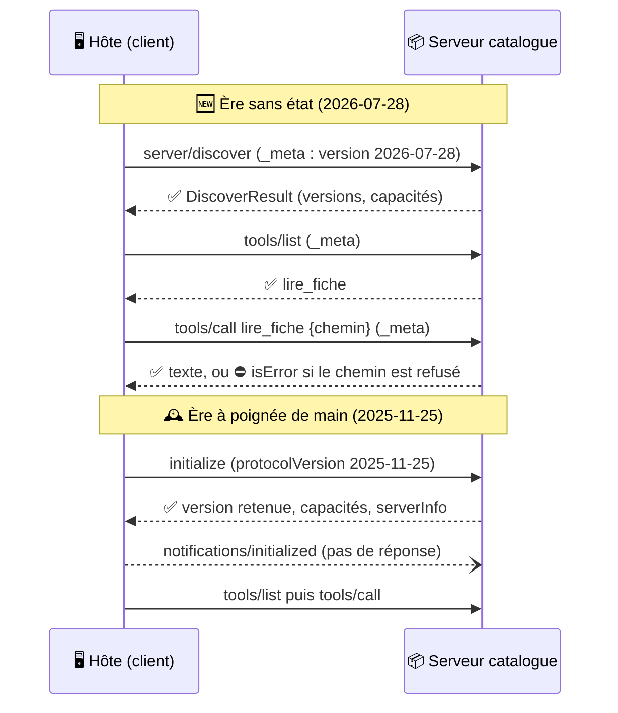

<!-- SPDX-FileCopyrightText: 2026 Gabrielle Magnan -->
<!-- SPDX-License-Identifier: MIT -->
# Serveur MCP stdio en Python, bibliothèque standard seulement

## Ce que montre l'exemple

`serveur_catalogue.py` est un serveur MCP complet en moins de 400 lignes commentées :

- il parle **JSON-RPC 2.0** sur **stdio**, un message par ligne ; ses journaux vont sur stderr, jamais sur stdout ;
- il expose **un seul outil, en lecture seule**, `lire_fiche`, sur un petit catalogue **synthétique** (`donnees/index.json` et trois fiches `FICHE-001` à `FICHE-003`) ;
- il **refuse tout chemin qui sort de sa racine** : chemin absolu, remontée `..`, lien symbolique qui pointe dehors, extension autre que `.json` ou `.md`, fichier de plus de 64 Kio ;
- il ne fait **aucun appel réseau** et n'ouvre aucun port ;
- il distingue les deux façons de signaler une erreur : **erreur de protocole** (outil inconnu : code `-32602`) et **erreur d'exécution d'outil** (chemin refusé : résultat avec `isError: true`, que le modèle peut lire et corriger).

### Deux révisions du protocole, un seul serveur

La spécification MCP a changé en profondeur avec la révision **2026-07-28** : elle **supprime** la poignée de main `initialize` / `notifications/initialized`. Chaque requête porte désormais sa version et les capacités du client dans `params._meta`, et le serveur doit répondre à `server/discover`. La révision précédente, **2025-11-25**, garde la poignée de main.

Claude Code embarque deux moteurs MCP : la page MCP de sa documentation indique que le moteur « v2 » ajoute la révision 2026-07-28, et que la variable `MCP_SDK_GENERATION` choisit `v1` ou `v2`. Le serveur d'exemple est donc **à deux ères** (« dual-era » dans la spécification) : il sert un client ancien comme un client récent.



| Ce que reçoit le serveur | Ce qu'il fait |
|---|---|
| Une requête avec `_meta["io.modelcontextprotocol/protocolVersion"]` = `2026-07-28` | ✅ Il la traite sans état. |
| La même, avec une version inconnue | ⛔ Erreur `-32022` (`UnsupportedProtocolVersion`) qui liste les versions acceptées. |
| La même, sans `clientCapabilities` dans `_meta` | ⛔ Erreur `-32602` : requête malformée. |
| `initialize` | ✅ Poignée de main 2025-11-25 ; une version inconnue est ramenée à `2025-11-25`. |
| `tools/list` avant `initialize`, sans `_meta` | ⛔ Erreur : il faut l'un ou l'autre. |
| Un lot JSON (`[...]`) | ⛔ Erreur `-32600` : les lots ne font plus partie des révisions récentes. |

L'option `--eres heritee` ou `--eres moderne` restreint le serveur à une seule ère : les tests s'en servent pour vérifier le repli du client.

## Installer

Rien à installer : Python 3.9 ou plus récent suffit (testé ici avec 3.14). Le serveur ne s'enregistre nulle part tout seul ; pour le déclarer à Claude Code, voir le dossier [`../mcp-consommateur/`](../mcp-consommateur/README.md).

Lancement à la main, pour voir qu'il attend :

```bash
python -I -B serveur_catalogue.py
```

Le terminal reste muet : c'est normal, un serveur stdio attend un client sur son entrée. On le ferme en fermant l'entrée (Ctrl+D, ou Ctrl+Z puis Entrée sous Windows).

- `-I` : mode isolé (ni le dossier courant ni les variables `PYTHON*` n'influencent les imports) ;
- `-B` : aucun fichier `.pyc` écrit.

## Tester

```bash
python -I -B -m unittest discover -s exemples -p "test_*.py"
```

`test_serveur_catalogue.py` lance le serveur en **sous-processus** et joue les deux séquences : `initialize`, `notifications/initialized`, `tools/list`, `tools/call` ; puis `server/discover`, `tools/list`, `tools/call` avec `_meta`. Il vérifie aussi chaque refus de chemin, l'outil inconnu, la version non prise en charge, le JSON illisible et les lots.

Le test du lien symbolique est **sauté** quand le système ne permet pas d'en créer un (cas courant sous Windows sans le mode développeur).

## Limites

- C'est un exemple d'apprentissage : pas de pagination, pas de `subscriptions/listen`, pas de ressources ni de prompts, pas de journalisation MCP (`notifications/message`).
- Les annotations `readOnlyHint` et `openWorldHint` sont des **indices** : la spécification dit qu'un client ne doit pas s'y fier venant d'un serveur non fiable. C'est le code de `lire()` qui garantit la lecture seule.
- Un serveur local tourne **avec vos droits**. La garde de chemin limite ce que *cet* outil lit ; elle ne remplace ni la revue du code, ni le principe « une donnée confidentielle n'est jamais dans la racine d'un serveur d'exemple ».
- Pour un vrai projet, le SDK officiel Python (`mcp`) évite de réécrire le protocole ; l'exemple n'en dépend pas, pour rester lisible et sans installation.

## Sources lues le 2026-11-02

- Spécification MCP, [Overview (latest)](https://modelcontextprotocol.io/specification/latest) : révision courante 2026-07-28.
- [Key Changes 2026-07-28](https://modelcontextprotocol.io/specification/2026-07-28/changelog) : suppression de `initialize`, `_meta` par requête, `server/discover`, `resultType`, `ttlMs` et `cacheScope`, code `-32022`.
- [Versioning and Compatibility 2026-07-28](https://modelcontextprotocol.io/specification/2026-07-28/basic/lifecycle) : ères, matrice de compatibilité, serveur à deux ères.
- [Base protocol 2026-07-28](https://modelcontextprotocol.io/specification/2026-07-28/basic/index) : champs `_meta` requis, codes d'erreur.
- [stdio 2026-07-28](https://modelcontextprotocol.io/specification/2026-07-28/basic/transports/stdio) : une ligne par message, stderr pour les journaux, arrêt par fermeture de stdin, sonde de compatibilité.
- [Discovery 2026-07-28](https://modelcontextprotocol.io/specification/2026-07-28/server/discover) et [Tools 2026-07-28](https://modelcontextprotocol.io/specification/2026-07-28/server/tools).
- [Schema 2026-07-28](https://modelcontextprotocol.io/specification/2026-07-28/schema) : `ToolAnnotations`, `ListToolsResult`, `UnsupportedProtocolVersionError`.
- [Lifecycle 2025-11-25](https://modelcontextprotocol.io/specification/2025-11-25/basic/lifecycle) et [Tools 2025-11-25](https://modelcontextprotocol.io/specification/2025-11-25/server/tools) : la poignée de main et les messages de l'ère précédente.
- Claude Code, [Connect Claude Code to tools via MCP](https://code.claude.com/docs/en/mcp.md) : moteurs v1 et v2, `MCP_SDK_GENERATION`.
