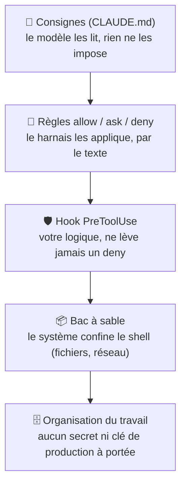

<!-- SPDX-FileCopyrightText: 2026 Gabrielle Magnan -->
<!-- SPDX-License-Identifier: MIT -->
# Un `settings.json` de projet commenté : permissions et bac à sable

Les fichiers de réglages sont du **JSON strict** : un commentaire `//` ou une virgule finale est une erreur. Les commentaires sont donc ici, dans le README ; le fichier à copier est `exemple.settings.json`, à placer en `.claude/settings.json` à la racine du projet.

## Le fichier, ligne à ligne

```jsonc
{
  // Autocomplétion et validation dans l'éditeur. Le schéma peut avoir du retard sur la CLI.
  "$schema": "https://json.schemastore.org/claude-code-settings.json",
  "permissions": {
    "allow": [                                // ✅ sans demande
      "Bash(git status)",                     // correspondance exacte
      "Bash(git diff --staged)",              // formes exactes seulement, sans joker (voir sous le bloc)
      "Bash(git log --oneline)",
      "mcp__catalogue__lire_fiche"            // l'outil du serveur d'exemple, par son nom exact
    ],
    "ask": [                                  // ❓ toujours demander
      "Bash(git diff *)",                     // l'espace avant « * » compte : « git diff* » prendrait « git diff-tree »
      "Bash(git log *)",                      // les autres formes de git diff et de git log
      "Bash(py*unittest*)",                   // les tests, sous toutes leurs formes (py, python ou python3, toutes options) : la découverte exécute des fichiers que Claude peut écrire
      "Bash(just *)",                         // les recettes du justfile lancent les mêmes tests et contrôles
      "Bash(git commit *)",                   // la porte de commit lance les contrôles : relisez git status avant
      "Bash(git push *)",
      "WebFetch"                              // toute récupération de page web
    ],
    "deny": [                                 // ⛔ jamais
      "Read(./.env)",                         // « ./ » : relatif au dossier courant ; « /.env » ancrerait au dossier de travail principal
      "Read(./.env.*)",
      "Read(./secrets/**)",                   // un deny Read bloque aussi Edit et Write sur ce chemin…
      "Edit(./secrets/**)",                   // … mais pas NotebookEdit : d'où ce deny Edit explicite
      "Edit(./.claude/settings.json)",        // ce fichier même, qui porte toutes ces règles
      "Edit(./.claude/hooks/**)",             // ce qui s'exécute sans demande ne s'écrit pas par Claude (voir sous le bloc)
      "Edit(./.claude/settings.local.json)",  // le fichier où chaque poste déclare ses hooks
      "Edit(./exemples/mcp-serveur/**)",      // le serveur MCP d'exemple, lancé à chaque session
      "Edit(./.mcp.json)",                    // le fichier qui le déclare
      "Edit(./exemples/mod/bilan-outils/**)", // le mod d'exemple : son module, hooks.json et plugin.json
      "Edit(./justfile)",
      "Edit(./.githooks/**)",
      "Edit(./.git/config)",                  // core.hooksPath y déclare la porte de commit
      "Bash(curl *)",
      "Bash(wget *)"
    ],
    "disableBypassPermissionsMode": "disable" // interdit le mode qui saute toutes les demandes
  },
  "sandbox": {
    "enabled": true,                          // confinement du système pour les commandes shell
    "autoAllowBashIfSandboxed": false,        // vaut true par défaut : une commande confinée passerait sans demande, même en Manual
    "allowUnsandboxedCommands": false,        // pas d'échappatoire hors du bac à sable
    "network": { "allowedDomains": [] },      // aucun domaine pré-autorisé : un autre hôte est demandé, refusé ou permis selon le mode
    "filesystem": { "denyRead": ["./secrets"] } // le shell ne lit pas non plus ./secrets
  }
}
```

En `allow`, `git diff` et `git log` n'ont que des formes exactes, et le reste va en `ask`. Avec un joker, `Bash(git diff *)` laisserait passer `git diff --no-index`, qui compare deux chemins quelconques du disque, y compris un fichier qu'un `deny` en lecture protège des outils de fichier de Claude, et `git diff --output=<fichier>`, qui écrit dans le fichier qu'on lui nomme ([documentation de git diff](https://git-scm.com/docs/git-diff), lue le 2026-11-09). `git log` accepte aussi `--output=<fichier>` et `-p` ([documentation de git log](https://git-scm.com/docs/git-log), lue le 2026-11-09). Même les formes exactes lancent ce que déclare la configuration git, lue dans `.git/config` et `~/.gitconfig` : un programme de diff externe (`diff.external`), un pilote de diff choisi par `.gitattributes`, les filtres `textconv`, actifs par défaut pour `git diff` et `git log`, et, pour `git status`, la commande `core.fsmonitor` ([documentation de git config](https://git-scm.com/docs/git-config), lue le 2026-11-09). Ne gardez ces trois règles `allow` que dans un dépôt dont vous avez relu la configuration git, et la vôtre.

**Ce qui s'exécute sans vous demander** lance les fichiers qu'il nomme sans demande, comme une règle `allow`. La seule liste de ces automatismes, et la source unique de leurs règles, est le tableau 17.3 du guide (section 17.2). Ce fichier en porte la part du projet partagé : un `deny` sur `Edit` pour le fichier lancé et pour celui qui le déclare, ici `.claude/hooks/**`, `.claude/settings.local.json`, le serveur d'exemple et `.mcp.json`, le mod d'exemple, le `justfile`, `.githooks/**` et `.git/config`, et ce fichier même, `.claude/settings.json`, qui porte toutes ces règles. Un mod fait exception : sans réglages gérés ni compte Team ou Enterprise, il peut approuver un appel qu'un `deny` refuse ([Configure permissions](https://code.claude.com/docs/en/permissions.md), lue le 2026-11-09) : lisez son code avant de le charger. La ligne d'état a les siennes dans vos réglages utilisateur (voir [`../ligne-etat/`](../ligne-etat/README.md)). Les tests, que Claude doit pouvoir écrire, ne se protègent pas ainsi : la porte de commit les lance quand une personne committe, après avoir relu `git status` et le diff, fichiers nouveaux compris. Les recettes passent par `Bash(just *)` en `ask`, comme les tests. Adaptez ces chemins à votre projet, et retirez la règle d'un automatisme que vous n'avez pas.

**L'espace avant le joker** : en `allow`, `Bash(git diff *)` garde son espace, sinon il prendrait aussi `git diff-tree`. En `ask`, une règle sans espace comme `Bash(py*unittest*)` attrape plus de formes, ce qui fait demander plus souvent : c'est le côté sûr.

## Comment les règles se combinent

- **Ordre d'évaluation** : `deny`, puis `ask`, puis `allow`. La première règle qui correspond dans cet ordre décide ; être plus précise ne fait pas gagner une règle.
- **Les listes fusionnent** entre fichiers (utilisateur, projet, local, géré) au lieu de se remplacer ; un `deny` de n'importe quel niveau l'emporte.
- **Confiance du dossier** : dans un `.claude/settings.json` versionné, les règles `allow` (et `additionalDirectories`, la plupart des `env`) n'agissent qu'**après** que chacun a fait confiance au dossier ; `deny` et `ask` s'appliquent **tout de suite**. C'est voulu : un dépôt cloné ne peut pas s'accorder des droits tout seul.
- **Ce qu'un fichier de projet ne peut pas faire** : `permissions.defaultMode` à `auto` ou `bypassPermissions` n'a pas d'effet depuis un fichier de projet ou local.
- **Chemins des règles `Read` et `Edit`** (syntaxe gitignore) : `//chemin` absolu, `~/chemin` depuis le dossier personnel, `/chemin` ancré à la source du réglage (pour un fichier de projet : le dossier de travail principal ; pour `~/.claude/settings.json` : `~/.claude/` !), `chemin` ou `./chemin` relatif au dossier courant. Sous Windows, les chemins sont normalisés en forme POSIX : `//c/**/.env` vise tous les `.env` du disque C.
- **Commandes composées** : `&&`, `||`, `;`, `|`, `|&`, `&` et les retours à la ligne sont reconnus. Pour passer sans demande, **chaque** sous-commande doit être autorisée ; un `deny` ou un `ask` s'applique dès qu'**une** sous-commande correspond, même dans un sous-shell.

## Pourquoi un `deny` par motif ne suffit pas

Une règle Bash compare le **texte** de la commande (après découpage et retrait de quelques enveloppes comme `timeout` ou `nice`). La doc le dit : elle couvre la forme que Claude écrit d'habitude, et **n'est pas une frontière de sécurité autour du programme**.

| Règle `deny` | Arrête | N'arrête pas |
|---|---|---|
| `Bash(curl *)` | `curl https://example.com` | `/usr/bin/curl https://example.com`, `sh -c 'curl https://example.com'` |
| `Bash(rm *)` | `rm -rf build/` | `/bin/rm -rf build/`, `bash -c 'rm -rf build/'` |
| `Bash(git push *)` | `git push origin main` | `git -C . push origin main`, `git -c push.default=current push origin main`, `git 'push' origin main` |

Les motifs qui tentent de restreindre les **arguments** sont encore plus fragiles : `Bash(curl http://github.com/ *)` ne voit ni `curl -X GET http://github.com/…`, ni `https://`, ni une redirection, ni `URL=… && curl $URL`. Et `Read(./.env)` protège le fichier des **outils de fichier** de Claude et des commandes de lecture que Claude Code reconnaît dans le shell (`cat`, `head`, `tail`, `sed`) ; une commande qui écrit, comme `tee` ou une redirection `>`, relève de la règle `Edit`. Ni la règle `Read` ni la règle `Edit` n'arrêtent une commande qui lit sans nommer le fichier (`grep -r motif .`), **ni** un script qui ouvre le fichier lui-même.

D'où la **défense en couches** : la règle de texte arrête le cas courant ; le bac à sable confine le geste au niveau du système, quelle que soit la forme de la commande (une connexion vers un hôte absent de `allowedDomains` est alors demandée, refusée ou permise selon le mode ; pour la refuser dans tous les modes, il faut la liste stricte du bac à sable (`sandbox.network.strictAllowlist`, qui compte aussi les domaines des règles `WebFetch(domain:…)` autorisées) ou `allowManagedDomainsOnly` dans les réglages gérés) ; le reste se règle en ne mettant pas le secret à portée.



### Ce que couvre le bac à sable, et ce qu'il ne couvre pas

| Couvert | Non couvert |
|---|---|
| Les commandes **Bash**, **PowerShell** et **Monitor**, et les processus qu'elles lancent | Les outils de fichier et de web (Read, Edit, Write, WebFetch, WebSearch) : ils suivent les règles de permission. `denyRead` n'arrête pas Read ; `allowedDomains` ne limite pas WebFetch. |
| | Les hooks, les serveurs MCP locaux, les serveurs LSP et la commande de ligne d'état : ils tournent **avec tous vos droits** |

⚠️ **Plateformes** : le bac à sable fonctionne sous macOS, Linux et WSL2. **Sous Windows natif, Claude Code exécute les commandes hors bac à sable** ; la doc renvoie vers WSL2. Sur un poste Windows sans WSL2, `sandbox.enabled` ne protège donc rien : les règles `deny` et `ask`, le mode de permission et l'absence de secret sur le poste font toute la différence. `sandbox.failIfUnavailable: true` fait **quitter** Claude Code au démarrage quand le bac à sable ne peut pas démarrer : sûr, mais bloquant pour les collègues sous Windows natif, d'où son absence ici.

## Installer et vérifier

1. Copiez `exemple.settings.json` en `.claude/settings.json` à la racine du projet (ou fusionnez-le avec l'existant).
2. Adaptez les chemins (`./secrets`) et les commandes à votre projet.
3. Dans une session : `/status` (ligne `Setting sources`) pour voir les fichiers chargés, `/permissions` pour les règles, et `claude doctor` pour les entrées rejetées.

## Tester

```bash
python -I -B -m unittest discover -s exemples -p "test_*.py"
```

`test_reglages.py` vérifie : la forme `Outil` ou `Outil(spécificateur)` de chaque règle, l'absence de règle `mcp__` avec parenthèses (Claude Code les saute), l'absence de joker non ancré en `allow` (ignoré), l'espace avant un `*` final en `allow`, des formes exactes seulement pour `git diff` et `git log` en `allow`, la protection des secrets, qu'aucune règle `allow` ne lance les tests ni un autre fichier que Claude peut écrire (les tests sont en `ask`, chapitre 17), que ce fichier même, les scripts des hooks et leur déclaration locale, le serveur MCP d'exemple et `.mcp.json`, le mod d'exemple, le `justfile`, `.githooks/` et `.git/config` sont protégés en écriture et `Bash(just *)` en `ask`, et que l'outil MCP autorisé est bien celui du serveur d'exemple.

## Limites

- La ligne `$schema` sert à l'éditeur ; il peut la télécharger : retirez-la sur un poste hors ligne.
- **Non testé ici** : l'effet réel des règles dans Claude Code, et le bac à sable lui-même (indisponible sous Windows natif, et l'activer demanderait de modifier une configuration réelle).
- La syntaxe exacte des chemins relatifs dans `sandbox.filesystem.denyRead` n'est pas détaillée dans les pages lues (les exemples de la doc utilisent `~/…` et `/tmp/…`) ; vérifiez le résultat par `/sandbox` sur votre plateforme.
- Une politique d'organisation (réglages gérés) passe avant ce fichier, et peut par exemple n'autoriser que ses propres règles (`allowManagedPermissionRulesOnly`).

## Sources lues le 2026-11-02

- Claude Code, [Configure permissions](https://code.claude.com/docs/en/permissions.md) : syntaxe des règles et jokers, ordre `deny` > `ask` > `allow`, commandes composées, enveloppes, tableau « What a Bash rule doesn't match », motifs d'arguments fragiles, règles `Read` et `Edit` (chemins `//`, `~/`, `/`, `./`), jokers d'outils MCP, `disableBypassPermissionsMode`.
- Claude Code, [Settings files and precedence](https://code.claude.com/docs/en/settings.md) : `$schema`, JSON strict, précédence, fusion des listes, confiance du dossier, `defaultMode` ignoré depuis un projet, `/status` et `claude doctor`.
- Claude Code, [Sandboxing](https://code.claude.com/docs/en/sandboxing.md) : clés `sandbox.*`, plateformes, ce que couvre le bac à sable, relation avec les règles de permission.
